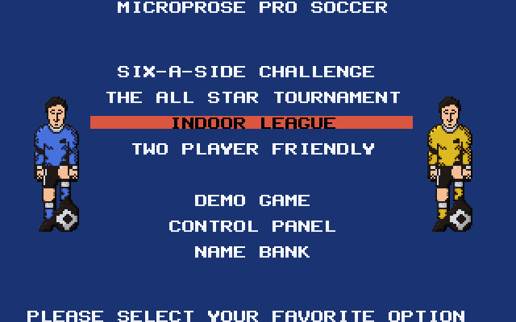
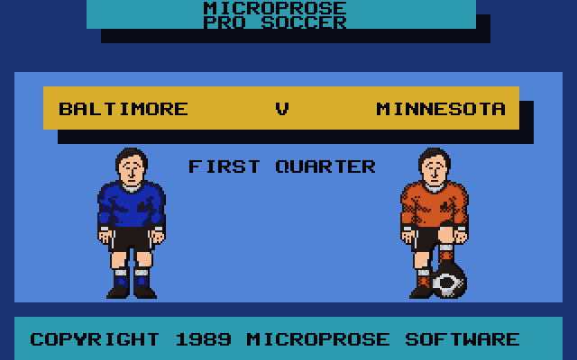
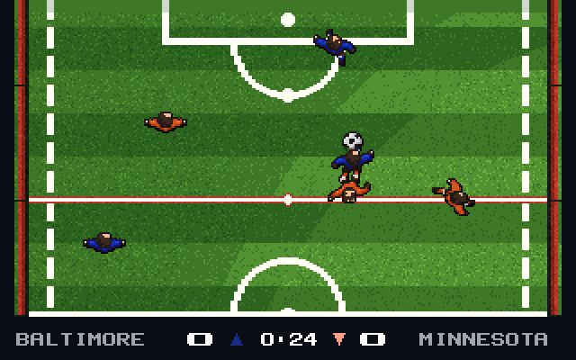
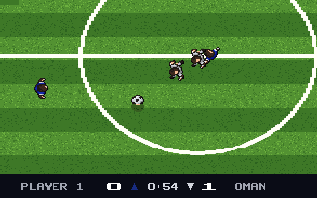
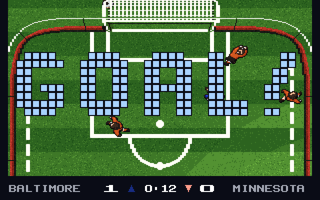
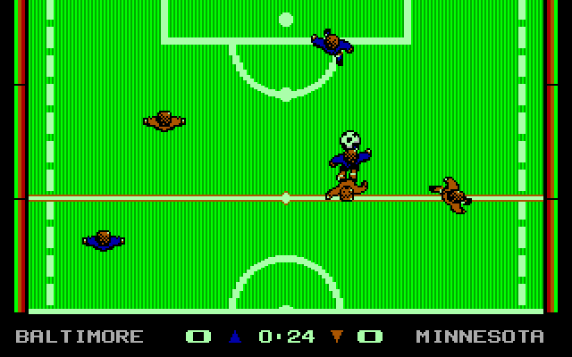

# MicroProse Pro Soccer (1989) — 역어셈블 → C → VGA 256색

원판 IBM 판(`SOCCER.COM` + 실내/실외 게임 `OPITCH.BIN` / `IPITCHC.BIN` + EGA 드라이버
`EGAIO.EXE`, 모두 8086 어셈블리)을 기계적으로 C 로 옮기고, 같은 게임 코드에 256색 그림과
애드립 소리를 입힌 개선판을 더한 것이다.

| 만든 것 | 무엇 |
|---|---|
| `SOCCER.EXE` | 원판을 그대로 옮긴 것. EGA 16색 화면을 VGA 13h 로 보인다 |
| `SOCVGA.EXE` | 같은 게임 코드 + 256색 그림(`SOCVGA.DAT`) + 애드립 음악/효과음(`SOUND.DAT`) |

게임 진행(규칙, 선수 움직임, 난수, 점수)은 원판과 한 바이트도 다르지 않다.
바로 쓸 수 있게 묶은 것은 [`release/`](release/) 에 있다.

| | |
|---|---|
|  |  |
|  |  |
|  |  |

## 어떻게 옮겼나

원판은 `SOCCER.COM` 이 실내/실외 게임을 고르고, 고른 게임(EXEPACK 으로 눌린 MZ 파일)을
읽어 들인 뒤 EGA 드라이버를 오버레이로 얹어 돌린다.

1. **풀기** — `tools/unexepack.py` 로 EXEPACK 을 풀고(`IN_UNP.EXE`, `OUT_UNP.EXE`),
   드라이버를 자리에 얹은 메모리 그림을 만든다 (`tools/image.py`).
2. **훑기** — `tools/scan.py` 가 시작점에서 코드를 따라가며 기본 블록을 모은다.
   간접 점프는 에뮬레이터로 실제 경로를 모아(`tools/cover.py`) 메우고, 손으로 찾은
   표/처리기는 `tools/roots_in.txt`, `tools/roots_out.txt` 에 적는다.
3. **옮기기** — `tools/asm2c.py` 가 게임 하나를 큰 함수 하나(`soc_run_in` / `soc_run_out`)로
   옮긴다. 되돌아오기와 간접 점프는 주소를 열쇠로 쓰는 `switch` 로 간다.
   플래그는 쓰는 곳이 있을 때만 계산한다.
4. **시계** — 원판은 PIT 120Hz 로 돈다. 옮긴 코드는 대기 루프(폴 지점)에서 틱을
   하나씩 흘리고, 도스에서는 그 틱이 실제 1/120 초가 되게 기다린다.
5. **대조** — `tools/difftest.py` 가 에뮬레이터(원판)와 옮긴 C 를 같은 키 대본으로 돌려
   폴마다 레지스터, 메모리 CRC, EGA 평면 CRC 를 견준다. 두 게임 모두 바이트 단위로 같다.

## 256색 개선판

원판 드라이버가 EGA 평면에 그리는 것은 그대로 두고, 점마다 **음영 층**을 따로 적는다.
음영은 '지금 무엇을 그리는 중인가'(드라이버 API 갈고리로 안다)에 따라 다르게 매긴다.

| 그리는 것 | 음영 |
|---|---|
| 경기장 타일 | 경기장 전체 좌표 → 깎은 줄무늬, 잔디 결, 선의 빛 (`SOCVGA.DAT` 의 지도) |
| 선수/공 | 프레임 안 좌표 → 둥근 입체감, 유니폼·피부·머리카락 구분 |
| 공 그림자 | 그 아래 잔디를 어둡게 → 잔디가 비쳐 보인다 |
| 글자/막대/바탕 | 장면(메뉴/경기)마다 다른 UI 색 |

화면 색 = EGA 색(0..15) × 16 + 음영. 팔레트는 지금 ATC 가 가리키는 EGA 색에서 펴 만든다.
그림 자료는 `python tools/mkvga.py` 가 원판 스프라이트와 타일에서 만든다 (`SOCVGA.DAT`).

실외 경기는 원판이 가로 미세 스크롤(속성 레지스터 13h)과 좁은 표시 폭(CRTC 1 = 25h)을
쓴다. 개선판은 이를 따라 배경이 선수와 함께 부드럽게 움직이고, 원판이 숨겨 두던 좌우
가장자리 대신 경기장이 화면 폭을 채운다.

## 소리

원판은 PC 스피커 하나로 4 채널 순서기를 돌린다. `python tools/mksound.py` 가 그 순서기를
에뮬레이터로 돌려 곡 16 개의 멜로디를 받아, 애드립(OPL2) 편곡으로 바꿔 `SOUND.DAT` 에 넣는다
(리드 + 파워 코드 + 베이스 + 리듬 모드 드럼). 원판에 없던 효과음도 합성해 더했다.

| 소리 | 언제 |
|---|---|
| "퍽" | 공이 발을 떠날 때 (스로인으로 던질 때는 안 난다) |
| 관중 함성 + 휘슬 | 골 |
| 심판 휘슬 | 킥오프, 쿼터 끝, 코너킥/골킥, 실내 판정(아웃·3 라인 위반·골키퍼 시간) |

함성/휘슬/큰 차기 소리는 사운드 블래스터의 디지털 소리(DMA)이고, 없으면 애드립으로 낸다.

## 빠르기

| DOSBox 사이클 (대략) | 실내 | 실외 |
|---|---|---|
| 40000 (486DX4-100) | 112 틱/초 | 110 틱/초 |
| 26800 (486DX2-66) | 96 틱/초 | 91 틱/초 |

원판 속도는 120 틱/초다. EGA 흉내가 가장 무거워서, 스프라이트·타일·스크롤처럼 뜨거운
드라이버 덩어리는 `socfast.c` 에서 C 로 한꺼번에 처리한다(에뮬레이터 대조로 같음을 확인).
화면은 게임이 쪽을 넘길 때만 합성한다 — 반쯤 그린 화면을 합성하지 않아 빠르고 찢김도 없다.

## 빌드

```
sh regen.sh           # 원판에서 soc_in.c / soc_out.c 를 다시 만든다
sh build_host.sh      # 윈도우 시험판 (hosttest.exe / hostvga.exe)
build.bat             # SOCCER.EXE   (djgpp)
build.bat vga         # SOCVGA.EXE
python tools/mkvga.py     # SOCVGA.DAT
python tools/mksound.py   # SOUND.DAT
```

djgpp 와 DOSBox 가 필요하다 (경로는 `build.bat`, `tools/dosshot.py` 안에 있다).
파이썬은 `capstone`, `unicorn`, `pillow` 를 쓴다.

```
python tools/difftest.py test/r1.txt 3000 v_in     # 원판과 대조
python tools/dosshot.py test/d_goal.txt out.png socvga.exe 1   # DOSBox 로 돌려 찍기
```

## 실행

```
SOCVGA          256색 판 (1) 실내  2) 실외 를 고른다)
SOCVGA 1 / 2    실내 / 실외로 바로
SOCCER          원판 그대로의 판
```

1P `W E R / S F / X C V` + `Space`, 2P 숫자판 `1..9` + `Enter`, `P` 멈춤,
`Ctrl+Q` 처음 화면으로. 환경 변수 `SOCNOSND=1`(소리 끔), `SOCSPK=1`(PC 스피커),
`SOCEGA=1`(EGA 색). 더 자세한 것은 [`release/README.TXT`](release/README.TXT).

---

원판 자료 파일은 MicroProse / Designer Software 의 것이다. 여기 있는 것은 원판을
가지고 있는 사람이 요즘 기계에서 돌려 보려고 옮긴 것이다.
